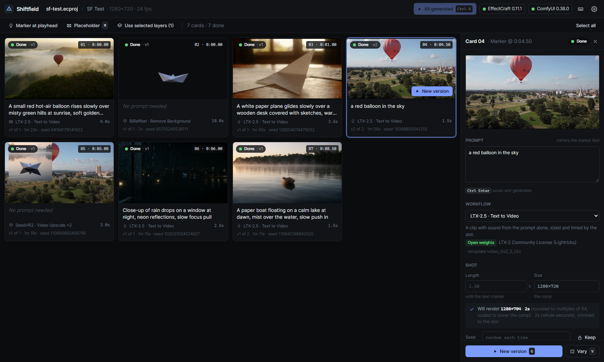
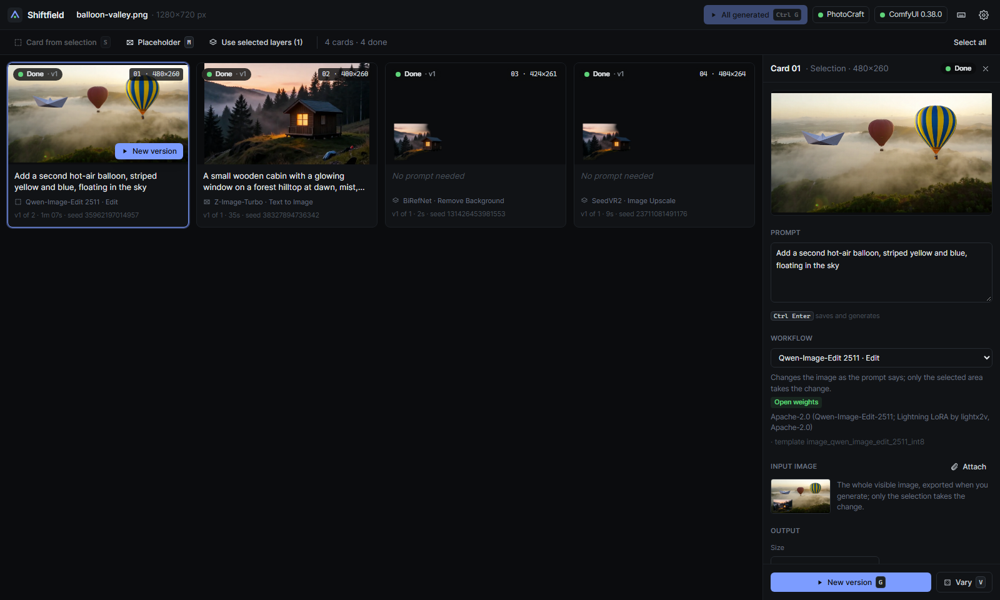

<p>
  <picture>
    <source media="(prefers-color-scheme: dark)" srcset="client/public/justae-logo-white.svg">
    
  </picture>
</p>

# JustAE Flow

<!-- PLACEHOLDER (author): one-line tagline. -->

<!-- PLACEHOLDER (author): presentation text — what JustAE Flow is, why it exists, the comparison with
     the subscription plugins it replaces. Keep the technical sections below as they are. -->

**Generative AI inside open-source compositing and image editing, on your own ComfyUI.** Markers and placeholder
layers in [EffectCraft](https://github.com/storytold/effectcraft), and selections and placeholder layers in
[PhotoCraft](https://github.com/storytold/photocraft), become a storyboard; whole comps are reframed, upscaled, cut
out, extended and slowed down; every result is made by a ComfyUI workflow and lands back in the project as something
new — never over the old one.


 <!-- PLACEHOLDER (author): screenshot or GIF -->

---

## What it does

A panel docked in EffectCraft opens the **Flow window** (the interface of JustAE Flow 2, the After Effects panel
that runs any ComfyUI workflow against the timeline). Four tabs: **Workflow** (any workflow of your ComfyUI, plus a
*Featured* set), **Marker** and **Storyboard** (shots from markers and placeholder layers, generated in series and
placed at their slots), and **Comp** (tools on the whole comp, its work area or a layer). It runs on your local
ComfyUI, your own Comfy API deployment, Comfy Cloud or `comfy-api-proxy` — one platform key for all of Comfy's side.

**Against the Higgsfield plugin for After Effects / Premiere Pro.** Its seven functions, as its page lists them
(higgsfield.ai/plugins/after-effects, copy of 22 Oct 2026; Higgsfield blog, 21 Jul 2026):

| Higgsfield function | What Higgsfield does | JustAE Flow | Status |
|---|---|---|---|
| Generate Video | text → clip on Higgsfield's servers, dropped into the timeline | LTX-2.5 text/image → video with sound, MiniMax H3 and Wan 2.2 first + last frame, or any video workflow of your ComfyUI — per marker pair or placeholder, in series, at its slot | **done** |
| Generate Image | text → still into the timeline | Z-Image-Turbo (or any image workflow) on a placeholder; Qwen-Image-Edit inside a PhotoCraft selection | **done** |
| Reframe | *crops* to 9:16, 16:9, 4:3, 3:4, 21:9, 1:1 with subject tracking | **generates** the space the new format needs (Wan 2.1 VACE outpainting) in 9:16, 4:5, 1:1, 16:9, 21:9, 4:3; the crop with SAM 3 tracking is there too (*Advanced ▸ Crop with tracking*); 3:4 is not offered | **different** |
| Remove Background | alpha key from any clip | SAM 3 tracked matte set as a luma track matte (the clip untouched), ProRes 4444 master with alpha; BiRefNet for stills | **done** (hard edges on hair: see limits) |
| Draw to edit | sketch on the frame → inpainting | Wan VACE inpainting from a drawn mask (the official template `video_wan_vace_inpainting` is identified, not built) | **planned** |
| Upscale | "up to 4K or 8K" | SeedVR2 ×2, ×4 in two passes, original colours kept; verified here up to 2160×3840 on a 16 GB GPU; 8K not claimed | **done** (to 4K) |
| Edit Video | prompt-based editing | Restyle (LTX-2.5 video-to-video or VACE with a reference) is not built | **planned** |

Only here: **Extend** a shot by 2–5 s carrying on the motion of its last frames, **Slow motion / fps** (RIFE, FILM),
a **Social pack** (several formats, their upscales and masters in one queue), **Describe the clip** (a local
vision-language model writes the prompt from your frames), a **storyboard** built from the timeline's markers and
placeholders with versions and status colours, and an estimate of time and credits under every Generate button.
Higgsfield has things this does not: "Seed audio" (voices, ambience), an MCP bridge and its own model catalogue.

## Setup from zero

You need: **Node.js 22.18+**; **EffectCraft 0.11.1+**; **ComfyUI 0.38+** with the official templates package (it
ships with ComfyUI), reachable over HTTP; **ffmpeg** on the PATH (masters, Extend, Describe the clip). The LTX-2.5
workflows need a GPU with 16 GB or more; the Wan VACE 14B reframe is meant for a cloud GPU with 48 GB or more.

```bash
git clone <REPO_URL> justae-flow && cd justae-flow
npm run setup        # npm install + build the UI + enable the pre-commit secret scan
npm run launch       # the server, EffectCraft with its control channel, and the Flow window docked beside it
```

On Windows, double-click **JustAE Flow.cmd** instead (`node scripts/launch.ts --shortcut` puts a shortcut to it on
the desktop). EffectCraft opens its control channel only when started with `--control 9877`, so the launcher starts
it that way; an EffectCraft already open without it cannot be joined — the launcher says so and leaves it alone
(save, close it, launch again). `npm start` runs the server alone on http://127.0.0.1:5199.

1. **The panel.** In EffectCraft: *Preferences ▸ Scripting & Expressions ▸ Allow Scripts to Write Files and Access
   Network*; then *File ▸ Scripts ▸ Install ScriptUI Panel…* → `extensions/effectcraft/JustAE Flow.jsx`; then
   *Window ▸ JustAE Flow*. It shows whether the server and EffectCraft's channel are up, opens the Flow window, adds
   marker pairs and placeholders, runs the layer tools, and says where they run.
2. **Your ComfyUI.** *Settings ▸ ComfyUI address* (default `http://127.0.0.1:8188`). `npm run verify:workflows`
   lists what it can run and the download URL of every missing model file.
3. **The one key** (optional — without it everything stays local). From
   [platform.comfy.org ▸ API Keys](https://platform.comfy.org/profile/api-keys), pasted once in *Settings ▸
   Resources*. The server keeps it in `comfy-api-key.txt` in your user folder (`%APPDATA%\JustAE Flow`,
   `~/Library/Application Support/JustAE Flow`, `~/.config/JustAE Flow`); the window only ever gets back whether
   one is set and its last four characters. It serves Comfy Cloud and your deployments.
4. **Resources.** *Settings ▸ Resources* lists Local, Comfy Cloud, your deployments and `comfy-api-proxy`, and a
   table of which one each task uses (see [Resources and credits](#resources-and-credits)).
5. **A deployment for the heavy tasks** (optional; see [Your own deployment](#your-own-deployment)).

Settings live in your user folder, never in the project or the repository; `.env.example` lists the variables that
override them. The PhotoCraft storyboard (http://127.0.0.1:5199/storyboard/) has its own setup guide.

### The Flow window, docked

EffectCraft docks only ScriptUI panels — it has no web panels like After Effects' CEP — so Flow 2's interface runs in
an app window of Edge or Chrome. On Windows it opens at EffectCraft's right edge, at full height, with EffectCraft
narrowed to make room, and it follows EffectCraft when it is moved, resized, minimized or restored. Drag it away to
undock it; **Open JustAE Flow** in the panel docks it again and never opens a second one. On macOS and Linux it opens
as a window of its own.

## The tabs

| Tab | What you do in EffectCraft | What Flow does |
|---|---|---|
| **Workflow** | — | lists the workflows of your ComfyUI (searchable), reads each graph and builds a form from it; the comp fills size, length and frame rate. *Featured* (above the library) lists the bundled workflows with where each runs. *Edit in ComfyUI* opens the editor on that workflow; Ctrl+S there saves back to the same file. The *Pipeline* lists the stages of a production and whether their nodes are installed |
| **Marker** | add comp markers in **pairs** around each gap to fill | one shot per pair, in time order; the clip comes out exactly as long as the gap. Or one clip at the playhead |
| **Storyboard** | block the cut out with **adjustment layers** (eye on) | one shot per placeholder: its in and out points are the slot, its label colour comes back on the generated clip, its eye is switched off once the clip is placed |
| **Comp** | open the comp; set a work area or pick a layer if you want | tools on the comp as a whole — see [The Comp tab](#the-comp-tab) |

Every shot row has its own workflow, prompt and inputs (a frame or the work area from the comp, an attached file).
Shots run in series with live progress and previews; each generation gets its own folder next to the project
(`<Project>_JustAE-Flow/<Comp>/shot_001_…/`) with its inputs, output, the workflow that ran and a `job.json` of every
value used. *Save setup / Load setup* keep a shot list as a file; the history lists every run. Using the storyboard:

1. Open a composition. For **Marker**, add markers in pairs around each gap (or *+ Marker pair* in the panel); for
   **Storyboard**, add adjustment layers (*+ Placeholder*), move and trim them.
2. Pick a workflow in the **Workflow** tab — or per shot, in its row.
3. Open a row: the prompt and that workflow's inputs. Fields the comp can fill say *from comp*.
4. **Generate clip** runs the ticked shots in series and places each clip at its slot, in the comp that was open when
   you pressed it.

The panel's **layer tools** work on the selected clip: Cut out a subject (SAM 3, a luma track matte), Reframe
(generate the new space, Wan VACE 14B or the 1.3B draft), Auto crop (SAM 3, Position keyframes that follow the
subject), Upscale ×2 (SeedVR2, laid exactly over the source, which is switched off — not deleted).

## The Comp tab

The Storyboard makes things *inside* a comp; the Comp tab transforms the comp itself — or its work area, or a layer —
into something new beside it. Nothing in your comp is changed or deleted: a result is a new comp ("*&lt;Comp&gt;* ·
9:16") or a layer above, the original kept.

**Source**: *Work area* (the default when one is set), *Whole comp*, or *Layer*. The work area and the whole comp are
rendered by EffectCraft when the run starts (its render queue, ProRes 422 HQ, never longer than *Settings ▸
Work-area render cap*, default 8 s) into the run's folder and imported, so the result stands on exactly what the
model saw. *Layer* uses the layer's own file: the layer picked when you click the chip, which stays the source while
EffectCraft selects other layers (it selects every result it places); a different selection is offered, never taken.

| Tool | What it runs | What it makes |
|---|---|---|
| **Reframe** — 9:16 · 4:5 · 1:1 · 16:9 · 21:9 · 4:3, *Draft* / *Final* | Wan 2.1 VACE outpainting (`vace-reframe-draft` 1.3B / `vace-reframe` 14B) | a new comp at the delivery size: the generated video fills it, your render or clip on top, untouched, with a soft edge. *Advanced ▸ Crop with tracking* runs the SAM 3 auto crop instead |
| **Upscale** — ×2, ×4, *Keep original colours* | SeedVR2 3B (`seedvr2-upscale`); ×4 is two ×2 passes | a new comp at the target size (stated before the run), your original under it, switched off. 8-bit H.264 (EffectCraft 0.11.1 decodes no other H.264). *Keep original colours* (default) sets SeedVR2's own colour correction to `wavelet` |
| **Cut-out** | SAM 3 tracking (`sam3-matte`), the subject named in a word | from a layer: a matte above it, set as its luma track matte; from the comp: a new comp with the render and its matte. **Export with alpha** writes a ProRes 4444 `.mov` with ffmpeg |
| **Extend** — +2, 4 or 5 s, "What happens next" | LTX-2.5 with a **video guide** (`ltx25-extend`, from the official template `video_ltx2_5_flf2v`): the source's last 17 frames (0.7 s at 24 fps; 9 when the source is shorter) go in through the core `LTXVAddGuide` at frame 0 of the new clip, and `LTXVCropGuides` takes them off the latent before decoding. From a still (or fewer than 9 frames): LTX-2.5 image-to-video from the last frame (`ltx25-i2v`) | a new layer at the source's out point, above it, at the source's size and frame rate, with its own sound; the card says "continues the last 0.7 s of motion". The model makes guide + 8k new frames (17 + 48 = 65 for 2 s at 24 fps); the guide frames come back first and are trimmed off. A comp too short to hold it is lengthened. Nothing is rendered: the render cap does not apply |
| **Slow motion / fps** — ×2 slow, ×4 slow, *fps → 2 × fps* | `utility_video_frame_interpolation`: RIFE (`interp-rife`, default, MIT) or FILM (`interp-film`, the template as it ships, Apache-2.0) | a new comp: slow motion at the source's rate, (n − 1) × k + 1 frames, the sound left out; or twice the rate for the same length, the sound kept. Your original in it, switched off |
| **Social pack** — any of the six formats, *Draft / Final*, *+ Upscale ×2*, *Masters* | the Reframe of each format in the queue; then, if asked, SeedVR2 ×2 of each result and a master of each last comp | one comp per format (and its ×2 comp); a master per format next to the project (EffectCraft renders ProRes 422 HQ, ffmpeg writes ProRes 4444 or a PNG 16-bit sequence). *Results* shows the pack together |

**Describe the clip** (next to the prompt of Extend, Reframe and Social pack): four frames of the source — the last
3 s for Extend, the whole span for a scene — go to **Qwen3-VL-4B** on your **local** ComfyUI (`describe-clip`, from the
official template `llm_qwen3vl_text_gen`, core `TextGenerate`), which writes what it sees into the prompt for you to
edit (*undo* puts your text back). It is offered only when the model file is on the local ComfyUI and that ComfyUI is
on this machine; nothing leaves it. The frames, the instruction and the answer are kept in `<media>/_describe/`.

Sizes per format — the generation frame follows one rule (`core/reframe/outpaint.ts`, `vaceGenSize`): Wan 2.1's own
frame where the format is its own, otherwise the size with exactly that aspect, both sides multiples of 16, whose
pixel count is nearest to that frame's. The delivery comp is 1080 px on its short side. The model is shown the clip
less a margin where it meets new space (1.5 × the soft edge + 8 px), so whatever it draws at its own edge lies under
the opaque original.

| Format | Final (14B) | Draft (1.3B) | Comp |
|---|---|---|---|
| 9:16 | 720×1280 | 480×832 | 1080×1920 |
| 4:5 | 832×1040 | 576×720 | 1080×1350 |
| 1:1 | 960×960 | 624×624 | 1080×1080 |
| 16:9 | 1280×720 | 832×480 | 1920×1080 |
| 21:9 (7:3) | 1456×624 | 1008×432 | 2520×1080 |
| 4:3 | 1088×816 | 704×528 | 1440×1080 |

Each card shows the comp's own frame at the playhead next to what it will make, says what the run will make before it
runs, and has the resource chooser and the estimate of the other tabs: each tool routes by its row of *Settings ▸
Resources* (Reframe → *Generative reframe* / *Reframe draft*, Upscale → *Upscale*, Cut-out → *Cut-out / matte*,
Extend → *Generate video*, Slow motion → *Slow motion / fps*), and a pick on the card holds for that tool. Technical
choices (seed, crop mode, colour correction) are under *Advanced*, with the workflow and the template it comes from.

**Results** lists the comp's runs: running ones with their phase, a bar and *Cancel*; finished ones with their time,
the credits derived from it where the resource bills, *Open comp*, *Compare* (original ⇄ result by hiding and showing
layers; nothing is deleted) and the versions — the same tool on the same source again makes the next version. Runs
go through one queue, one at a time. **A queued run does not take your comp away**: EffectCraft renders and places
only in the active comp, so a run opens its comp while it works; when it ends, its result stays in front only if you
were on the comp it started from — otherwise the comp you were on comes back and *Results* offers *Open comp*.

Keys: **G** runs the open card, **Esc** cancels the running run, **Tab** compares the last result. Files: everything a
run makes goes into `<project>.justae-flow/<run id>/` next to the `.ecproj` — the render, the result, a picture of
it, the exact graph submitted (`submitted_<time>.api.json`) and the `job.json` (tool, source, sizes, resource, times,
seed, model swaps; for Extend the guide frames and the frames that came back).

## Featured workflows

Above the Workflow tab's library: LTX-2.5 image → video and text → video, MiniMax H3 first + last frame, Wan 2.2 first
+ last frame, Z-Image-Turbo, Qwen-Image-Edit 2511, SeedVR2 ×2 and SAM 3, each with where it runs — "runs on: Local ✓ ·
Cloud ✗ · Proxy ✓ · *your deployment* ✓/?" from the probes (a deployment: ✓ once a run of that workflow finished
there) — and, when the local ComfyUI lacks something, each missing file with the URL its template downloads it from;
one that runs nowhere stays listed, greyed. *Use it* makes it the workflow of the Marker and Storyboard tabs (with your
ComfyUI's precisions swapped in, e.g. LTX int8 → nvfp4). The LTX-2.5 cards carry the LTX-2.x licence line and its
link. MiniMax H3 has *Draft / Final*: *Draft* is the base model, 20 steps (no turbo LoRA: see the limits); *Final* runs
the draft, then SeedVR2 ×2 on its result as a second job on the same resource (original colours kept); its card carries
the licence note (MiniMax commercial licence for locally generated outputs; in the EU: to be verified).

## Workflows

All bundled workflows are **official ComfyUI templates** with **open weights**, converted to the API format by
`scripts/build-workflows.ts` (no hand-edited graphs; every node checked in the server's `object_info`). No partner
nodes, no closed APIs.

| Id | Template (comfyui-workflow-templates 0.11.76) | Task | Weights licence |
|---|---|---|---|
| `ltx25-t2v` | `video_ltx2_5_t2v` | text → video with sound | LTX-2.x Community License |
| `ltx25-i2v` | `video_ltx2_5_i2v` | frame under the marker (or an attached image) → video | LTX-2.x Community License |
| `ltx25-extend` | `video_ltx2_5_flf2v` | a clip's last frames (video guide) → the next seconds (Comp ▸ Extend) | LTX-2.x Community License |
| `describe-clip` | `llm_qwen3vl_text_gen` | a few frames → a paragraph for the prompt (local only) | Apache-2.0 (Qwen3-VL-4B) |
| `zimage-t2i` | `image_z_image_turbo` | text → image | Apache-2.0 |
| `seedvr2-upscale` | `utility_seedvr2_3b_int8_upscale_video` | video ×2 restoration upscale | Apache-2.0 |
| `birefnet-rmbg` | `utility_birefnet_remove_background` | still → cut-out with alpha | MIT |
| `sam3-matte` | `utility_video_segment_sam3` | clip + subject name → tracked matte video (luma) | SAM License (Meta) |
| `sam3-reframe` | `utility_video_segment_sam3` | clip + subject name → a small mask per frame, for the auto crop | SAM License (Meta) |
| `vace-reframe` | `video_wan_vace_outpainting` | clip in a new aspect → the space around it generated (VACE 14B, 720p) | Apache-2.0 |
| `vace-reframe-draft` | `video_wan_vace_outpainting` | the same on the 1.3B model, 480p | Apache-2.0 |
| `qwen-edit` | `image_qwen_image_edit_2511_int8` | image + prompt → edited image (PhotoCraft selections) | Apache-2.0 |
| `seedvr2-upscale-image` | `utility_seedvr2_3b_int8_upscale_image` | image restoration upscale | Apache-2.0 |
| `interp-rife` | `utility_video_frame_interpolation` | frames in between (×2, ×4), RIFE VFI in place of the template's interpolator | MIT |
| `interp-film` | `utility_video_frame_interpolation` | the same, the template as it ships (core nodes, FILM) | Apache-2.0 |
| `h3-flf` | `video_minimax_h3_i2v` | first + last frame → video with sound (Featured) | MiniMax H3 open weights; commercial use of local outputs needs MiniMax's licence |
| `wan22-flf` | `video_wan2_2_14B_flf2v` | first + last frame → video (Featured) | Apache-2.0 |

What the build changes, per template: the BiRefNet preview becomes a save; the SAM 3 per-frame detection becomes the
core tracking nodes (`SAM3_VideoTrack` + `SAM3_TrackToMask`) and a save; the VACE graphs cut the clip to one run,
scale and crop it before the padding and swap the template's CausVid LoRA (CC BY-NC 4.0) for lightx2v's Apache-2.0
4-step LoRA (14B) or drop it (1.3B); `interp-rife` puts RIFE VFI (`ComfyUI-Frame-Interpolation`, checkpoint
`rife47.pth`) in place of FrameInterpolate; `h3-flf` wires a second image to the node's `last_frame` and drops the
turbo-LoRA branch (off in the template); `ltx25-extend` replaces the first-frame image with the source's last frames
(LoadVideo → GetVideoComponents → ImageFromBatch → the template's resize, stretched rather than centre-cropped so the
result can be laid back at the source's size, → LTXVPreprocess → LTXVAddGuide at frame 0, strength 1) and removes the
last-frame guide; `describe-clip` feeds a few frames instead of one image. A clip longer than one VACE run (125 frames)
goes in runs that each start from the last 8 frames the one before made, joined in ComfyUI. GIMM-VFI was an
interpolation engine until 25 Oct 2026; its S-Lab License 1.0 is non-commercial, so it is no longer shipped.

Each `workflows/<id>.json` manifest names the node fields the host fills in, the model files with their download URLs,
and the licence. If your ComfyUI has another precision of the same weights, JustAE Flow uses it and says so on the card.

```bash
npm run verify:workflows -- http://127.0.0.1:8188   # what your server can run, and the URLs of what is missing
```

## Resources and credits

**Settings ▸ Resources** lists the places a workflow can run. Everything there is kept by the server in your user
folder — the registry in `resources.json`, the platform API key in `comfy-api-key.txt`, the proxy's token in
`comfy-proxy-token.txt` — never in the project, the repository or the window's storage.

| Resource | Address | Protocol, key | Cost |
|---|---|---|---|
| **Local ComfyUI** | `http://127.0.0.1:8188` | ComfyUI's own HTTP + WebSocket protocol; no key | your GPU |
| **Comfy Cloud** | `https://cloud.comfy.org` | Comfy API v2 for jobs (`Authorization: Bearer`); the v1 Cloud API (`X-API-Key`) for the node catalogue, the model folders and the billing report | credits for GPU time |
| **Deployment** | `https://<deployment>.run.comfy.app` — `comfy deploy status` prints it | Comfy API v2, the same key | credits per second of GPU while a worker runs |
| **Your ComfyUI via [`comfy-api-proxy`](https://docs.comfy.org/development/comfyui-server/api-proxy)** | `http://127.0.0.1:8189` | Comfy API v2; none, or the proxy's `--token` | your GPU |

The key goes over https only, or over plain http to this machine. Running jobs on Comfy Cloud by API needs a paid
Cloud plan (*v1 Cloud API Overview*, "Subscription required"): measured on 25 Oct 2026, a free-tier key reads
billing, nodes and models but every submit is refused with 403 "API key authentication is not available for free tier
accounts". JustAE Flow shows those words, offers to run locally, and stops routing jobs to Cloud until the key changes
or **Check** is pressed. Comfy API v2 runs on the server through the official SDK (`@comfyorg/sdk` 0.5.0): inputs go up
as assets addressed by their blake3 hash, each Generate is one submission under one `Idempotency-Key` (a 429 — queue
full, or a deployment starting a worker — is retried under the same key for up to 10 minutes), the job is polled every
2 seconds, outputs come down through the server.

**Where each task runs.** A table on the same page sets, per task, Local, Cloud, a deployment, the proxy or **Auto**
(defaults: video Auto, image Local, generative reframe Cloud, reframe draft Local, upscale Cloud, matte Local, slow
motion / fps Local, restyle Auto). Auto is Local when the local ComfyUI has the workflow's nodes and models, else the
first other resource that has them; a row on a resource that is not set up falls back to Auto, so without a key
everything stays local. The resource on a **Generate** button overrides the table; each `job.json` records the
resource, why it was chosen, the execution time and the derived credits. What a resource can run is probed and kept
ten minutes: the local ComfyUI's `/api/object_info`; on Comfy Cloud the v1 `/api/object_info` and
`/api/experiment/models/{folder}`. A deployment and the proxy have no node catalogue on v2, so they are "unknown until
a workflow has finished there" (a proxy in front of the local ComfyUI is judged by that ComfyUI). What we found on
Comfy Cloud is in [docs/CLOUD_PROBE_2026-10-25.md](docs/CLOUD_PROBE_2026-10-25.md); the tests, with settings and
results, in [docs/TEST_LOG_2026-10-25.md](docs/TEST_LOG_2026-10-25.md) (Italian).

**Credits, and the billing lag.** When the resource of the next Generate bills, the header shows the account's
balance, read from the v1 billing report `GET /api/billing/usage/timeseries` (`summary.balance`, in **cents** despite
the `_micros` suffix, converted at 211 credits = 1 $; openapi-cloud.yaml and comfy.org/cloud/pricing). That report is
drawn from invoices, not live usage: the balance always carries the time it was read, is read again after every job
on Cloud or a deployment, and when it has not moved yet the window says so. It is cached five minutes.

**Estimates and costs are derived, never stated.** No endpoint returns a job's price (the v2 job carries
`metrics.execution_ms`; SDK `types.gen.d.ts`). So, under every Generate button:

- after a run: execution time × the GPU's rate — Comfy Cloud runs on the RTX PRO 6000, **736.39 credits per GPU hour**;
  a deployment bills at the rate of its GPU: RTX PRO 6000 736.39, H100 1,314.53, H200 1,626.81, B200 2,369.53
  credits/h (comfy.org/cloud/pricing, read 25 Oct 2026) — set in its card;
- before a run: the fastest and slowest earlier runs of the same workflow on the same resource and GPU, scaled by the
  slot for video, always with "≈" and its basis ("based on 3 runs on RTX PRO 6000"), or the rate alone when there is
  none ("first run: 12.3 cr/min"). A slot longer than any run on record is flagged. When the balance is under twice
  the estimate, a yellow line offers to switch to Local; a `402 insufficient_credits` ends the job with the same offer.

The run history the estimates come from is `runs.json`, in the same user folder.

### Your own deployment

A deployment bills while a worker runs, not per job: deployed with `--min 0` it scales to zero between jobs (the next
job waits for a worker: measured on 25 Oct, about 1–2 minutes from cold); with `--min 1` a worker stays up and bills
while idle — its card says how much a day. A generic recipe with comfy-cli (docs.comfy.org, *Comfy API Quickstart*;
comfy-cli's `comfy-build` and `comfy-deploy` skills):

```bash
pip install -U comfy-cli
comfy build init <dir> --name <name> --models-dir <ComfyUI>/models --custom-nodes-dir <ComfyUI>/custom_nodes
comfy build push
comfy build release create --target linux/nvidia --watch
comfy deploy refs compute          # GPU classes, regions, credits per hour, storage per GB-month
comfy deploy up <dir> --gpu <class> --region <region> --min 0 --max 1 --watch
comfy deploy status <dir>          # its endpoint: Settings ▸ Resources ▸ Add a deployment
comfy deploy stop <dir>            # ends the charge; keeps the endpoint and the staged models
```

Put in the Build only what the heavy tasks need: the models a bundled workflow names are in its manifest
(`workflows/<id>.json` → `models`, each with the URL its template downloads it from) — for example `vace-reframe` and
`seedvr2-upscale`, whose nodes are all core ComfyUI. Costs, as `comfy deploy refs compute` listed them on 25 Oct 2026
(comfy-cli 1.23.0): the GPU per hour while a worker runs (RTX PRO 6000 736.39 credits/h) and network storage for the
staged models at **42.2 credits (0.20 $) per GB per month** (how storage is billed in detail: to be verified). JustAE
Flow never builds, releases, deploys, starts, scales or stops anything on the platform: it talks to an endpoint you
already have. On v2 workflows go in API format, there are no live previews, and a deployment has only the nodes and
models of its build. To try v2 for free, run `pip install comfy-api-proxy` and `comfy-api-proxy` next to your ComfyUI.
`npm run probe:cloud` asks Comfy Cloud what it offers this account — read-only, no job, no credit.

A ComfyUI behind a router that asks for a bearer token (for example one you host yourself) also works as the *Local*
address: put its address in **Settings ▸ ComfyUI address** and its token in **Access token** (sent as
`Authorization: Bearer …`, and as `token=` on the WebSocket); a router's GPU menu (`/manager/monitor/pricing`) shows
up in **GPU for jobs**. Describe the clip is not offered on such an address: it runs only on this machine.

## How it works

```
 EffectCraft ──(control channel, JSON lines, 127.0.0.1:9877)──┐
   └ JustAE Flow panel (ScriptUI) ──(HTTP)──┐                 │
                                            │                 │
                         JustAE Flow server (Node, 127.0.0.1:5199)
                         · host bridge: Flow 2's host functions run inside EffectCraft (script.run)
                         · files, HTTP and WebSocket relays for the Flow window (session token)
                         · layer tools, the Comp tab and the PhotoCraft storyboard: engine, queue, versions
                                                               │
 Flow window (React, Flow 2's interface) ──(HTTP + SSE)────────┘──(HTTP/WS, SDK)── ComfyUI, Comfy Cloud, deployments
```

- **The host.** EffectCraft's scripting follows After Effects scripting, so Flow 2's host file
  (`extensions/effectcraft/flow-host.jsx`) runs inside EffectCraft through the control channel's `script.run`:
  markers, adjustment layers, import at a time with the label colour, frame capture (`saveFrameToPng`), work-area
  render, trims, the native dialogs. Differences measured on EffectCraft 0.11.1: the project name (`.ecproj`) and the
  temp folder (`Folder.temp` is null, so renders go into a folder the caller names); a render-queue value it already
  has is refused ("nothing to change"); `renderQueue.item(j)` hands out a new object each call.
- **Files** go through the server, limited to your user folder and the temp folder; **HTTP** to ComfyUI or a cloud API
  goes through a relay (no CORS, no token in a browser request); the ComfyUI **WebSocket** is relayed as server-sent
  events. Every route wants the session token the server writes into the page.
- **Lossless masters** (ProRes 4444, PNG 16-bit), Extend's guide clips and Describe's frames are made with ffmpeg.

```
client/      the Flow window (Flow 2's interface; bridge/ and lib/ are the parts that talk to the server)
extensions/  the EffectCraft panel and the host file
core/        host-independent: ComfyUI client, workflow conversion, manifests, storyboard types, reframe planning, the Comp tab tools
hosts/       one adapter per host app for the engine (effectcraft: a timeline, photocraft: a canvas)
server/      the host bridge and relays, the window dock, the engine (layer tools, Comp tab, PhotoCraft storyboard), settings, HTTP API
workflows/   bundled workflows: <id>.json manifest + <id>.api.json graph
scripts/     launch, build-workflows, verify-workflows, verify-effectcraft, selftest, scan-secrets
```

## Privacy and network

JustAE Flow listens on 127.0.0.1 only. It talks to things of your choosing: your EffectCraft or PhotoCraft (loopback)
and the resources you set up — your ComfyUI, and, once you add the key, Comfy Cloud (jobs, node catalogue, model
folders, billing report) and the deployment addresses you paste. Describe the clip talks only to a ComfyUI on this
machine. No telemetry, no account of its own, no other network access.

## Development

```bash
npm run typecheck
npm run selftest                 # offline: fake ComfyUI + in-memory hosts, end to end (uses ffmpeg when it is on the PATH)
npm run verify:workflows         # bundled workflows against a live ComfyUI (read-only)
npm run verify:effectcraft       # the storyboard as the engine sees a live EffectCraft
npm run probe:cloud              # what Comfy Cloud offers this account (read-only, no job, no credit)
npm run workflows:build          # regenerate workflows/*.api.json from the official templates
npm run scan:secrets             # also runs as the pre-commit hook
npm run dev                      # UI dev server on :5198 (proxying the API on :5199)
```

## Known limits

- One host at a time: switch between EffectCraft and PhotoCraft in *Settings ▸ App*. A Flow window for PhotoCraft is
  not in this version (PhotoCraft has its own storyboard page).
- PhotoCraft's control channel passes no pixels in memory: images cross through files in its automation folder.
- Upscale, background removal, subject matte and reframe from a *layer* take the layer's own file; a placeholder or a
  marker cannot feed them.
- The subject matte follows the subject as SAM 3 sees it; hair and motion blur get a hard edge (refine it in
  EffectCraft, or name another subject).
- The auto crop invents no pixels; the generative reframe does, at 720p (14B) or 480p (draft), so the new space is
  softer than the clip in the middle. On a 16 GB GPU the 1.3B draft takes about 6 minutes for 125 frames at 480p, and
  the 14B *Final* minutes per sampling step; one card makes at most four runs (about 20 s at 24 fps).
- The Comp tab renders a work area or comp as ProRes 422 HQ (about 76 Mb/s at 1280×704); Comfy Cloud takes uploads
  up to 100 MiB, so a longer render is refused before it is sent there.
- EffectCraft renders and places only in the active comp: a queued run opens its comp for the time it renders and
  places, then gives the front back (see *Results*).
- Extend carries on the motion of the last 17 frames; motion that started earlier than 0.7 s before the out point is
  seen only through those frames. The frames the model gives back for the guide are not pixel-identical to yours (they
  are trimmed off); at the cut, the level of the new frames can differ slightly from the source's (measured on 25 Oct:
  about 2 levels of 255, as with the single-frame path). Measured at 24 fps; other rates use the same rule (17 + 8k).
- MiniMax H3 *Draft* is the base model, 20 steps: a turbo LoRA is used for a draft only if it is the file the official
  template names, and the one this was checked against was not (the decision is the author's).
- Upscale past 4K is not verified on a 16 GB GPU (the card says so); a Social pack's *+ Upscale ×2* makes 4K comps
  (2160×3840 for 9:16), at the edge of what was verified.
- Storyboards written under the project's former name (`*.shiftfield.json`) are still read, where they are.

**To be verified:** whether the European Union is covered by MiniMax H3's licence for local outputs; the provenance of
`rife47.pth` (the node pack downloads it from mirrors) and the licence of Comfy-Org's FILM repackaging (its card says
"other"); how a deployment's network storage is billed in detail; the upload limit of a deployment; time and VRAM of a
full VACE 14B *Final* and of a full MiniMax H3 run on a 16 GB GPU; Wan 2.2 first + last frame end to end (its 14B
weights are not on the test machine); whether open weights run on Comfy Cloud count for the challenge's *Open Weights
Only*; the LTX-2.5 LoRAs of Lightricks' Creative Lab (gated on Hugging Face: their terms and licences).

## Licence

JustAE Flow is free software under the **GNU General Public License v3.0** ([LICENSE](LICENSE)). Third-party material
and model licences are listed in [NOTICE](NOTICE); model weights are not included — each manifest names the files and
where the official template downloads them. Read each licence before using outputs commercially. In short:

- **LTX-2.5** (the core video model): LTX-2.x Community License (11 Aug 2026): commercial use permitted for entities
  under USD 10M annual revenue (affiliates counted together), outputs belong to the user, published machine-generated
  content must be disclosed as such — [LICENSE-2_x](https://github.com/Lightricks/LTX-2/blob/main/LICENSE-2_x).
- **SAM 3** (cut-out, auto crop): SAM License (Meta) — royalty-free, commercial use included, with trade-control and
  lawful-use terms; it is an open-weights licence of its own, not an OSI licence.
- **MiniMax H3** (Featured only): commercial use of locally generated outputs needs a MiniMax commercial licence.
- Wan 2.1 / 2.2, SeedVR2, Z-Image-Turbo, Qwen-Image-Edit, Qwen3-VL, FILM: Apache-2.0; RIFE, BiRefNet: MIT.

The name and the JustAE logo are covered by [TRADEMARKS.md](TRADEMARKS.md), not by the code licence. EffectCraft and
PhotoCraft are products of the ArtCraft Team; JustAE Flow is independent and uses none of their marks. Higgsfield is a
trademark of its owner, named only to describe the comparison; Adobe, After Effects and Premiere Pro are trademarks of
Adobe Inc.

---

<!-- PLACEHOLDER (author): closing line with the link to JustAE and Homo Lapis. -->
