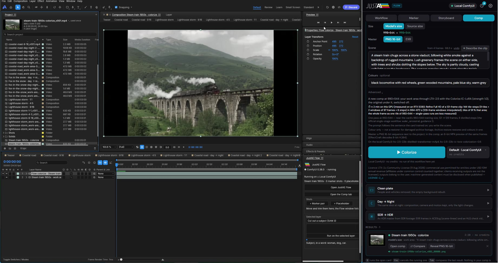

<p align="center">
  <picture>
    <source media="(prefers-color-scheme: dark)" srcset="client/public/justae-logo-white.svg">
    
  </picture>
</p>

<h1 align="center">JustAE Flow</h1>

<p align="center">
  <b>ComfyUI inside the open-source EffectCraft.</b><br>
  Your ComfyUI workflows, with any model, run against your timeline: generate shots, fill the cut between two clips,
  reframe with generated pixels, upscale, cut out, extend and restore whole comps — on your own GPU or on Comfy's.
</p>

<p align="center">
  <a href="docs/media/justae-flow-demo.mp4"></a><br>
  <sub>▶ <a href="docs/media/justae-flow-demo.mp4">Watch the two-minute demo</a></sub>
</p>

<p align="center">GPL-3.0 · any ComfyUI workflow, any model · open-weight presets · no telemetry · no account</p>

---

JustAE Flow is a plugin for [EffectCraft](https://github.com/storytold/effectcraft), the open-source compositor modelled
on After Effects. A window docked beside the timeline runs [ComfyUI](https://github.com/comfyanonymous/ComfyUI)
workflows against your comp. Placeholder layers and markers become a storyboard of generated shots. A **Comp tab**
turns the whole comp into something new: another format, a sharper master, a cut-out with alpha, a longer shot. Every
result lands in the project as a new comp or layer, never over your work, with its versions and the exact graph that
made it.

## Your ComfyUI, your workflows

<p align="center">
  
</p>

It is your usual ComfyUI, with your own workflows and your models. The Workflow tab lists the workflows saved in your
ComfyUI, or imports a file; each graph is read as a form, and the comp fills in its size, length and frame rate.
**Edit in ComfyUI** opens the same workflow in the ComfyUI editor: move around it, change its nodes, models and
settings, save with Ctrl+S, press Refresh, and the panel follows. JustAE Flow is model-agnostic: it reads a workflow's
inputs — prompts, images, size, length — not its model, so whatever model your ComfyUI runs, the Flow can use on your
comp. Nothing is fixed to one model: every shot, each storyboard row and each marker pair, picks its own workflow. The
**Featured** presets are a place to start: they say what is ready on your machine and download only the models you
pick. The Comp tab's tools are presets too, and you can change them.

JustAE Flow works only with ComfyUI — yours, or Comfy's in the cloud.

## What it does

<table>
<tr>
<td width="50%"></td>
<td><b>A storyboard from the timeline.</b> Block the cut with placeholder layers: each becomes a row with its own
workflow. Say what happens in each, press Generate: every shot is made with its sound (LTX-2.5 here), one after the
other, and dropped in its slot, sized and timed by it.</td>
</tr>
<tr>
<td></td>
<td><b>The shot between two clips.</b> Put a pair of comp markers around a cut, take the last frame of one clip and the
first of the next from the comp: MiniMax H3 generates the shot that joins them, with its sound, exactly as long as the
gap — then SeedVR2 ×2 or LTX Refine on top if you like. Wan 2.2, or any video workflow of yours, can fill it too.</td>
</tr>
<tr>
<td></td>
<td><b>Reframe that generates.</b> 16:9 to 9:16, 4:5, 1:1, 21:9 or 4:3: Wan 2.1 VACE paints the space the new format
needs instead of cropping your shot, which stays untouched in the middle, the new space matched to its colours. A
social pack makes several formats in one queue.</td>
</tr>
<tr>
<td></td>
<td><b>Upscale and finishing.</b> SeedVR2 ×2 or ×4 adds real detail and keeps the colours; LTX Refine rebuilds detail
to Full HD, 4K or 8K by tiles. Lightricks' IC-LoRAs work as VFX tools on the comp: Archive restore, Deblur,
De-compression, Colorize, Clean plate, Day → Night, SDR → HDR, with 16-bit masters.</td>
</tr>
<tr>
<td></td>
<td><b>Cut-out with alpha.</b> Name the subject in a word: SAM 3 tracks it through the clip, or LTX Alpha keeps soft
edges. The matte goes on the layer as a track matte; one click writes a ProRes 4444 with alpha.</td>
</tr>
<tr>
<td></td>
<td><b>Extend and slow down.</b> LTX-2.5 carries the motion of a shot's last frames into two to five new seconds, and a
local vision model can write the prompt from your frames. RIFE or FILM add the frames in between for slow motion.</td>
</tr>
</table>

## Your GPU, or Comfy's

Each task runs where you choose: your local ComfyUI, your own Comfy API deployment, or Comfy Cloud, all with one
platform API key. Before a run the button shows an estimate of time and credits; after it, what the run used. Without a
key everything stays on your machine.

## Get started

You need Node.js 22.18+, EffectCraft 0.11.1+, ComfyUI 0.38+ and ffmpeg.

```bash
git clone https://github.com/HomoLapis/justae-flow.git && cd justae-flow
npm run setup        # install, build the window
npm run launch       # the server, EffectCraft, and the Flow window docked beside it
```

On Windows, double-click **JustAE Flow.cmd** instead. The first time, the Workflow tab opens on **Get started**: it
finds your ComfyUI, says which featured workflows are ready, and makes a test image in your comp. No GPU? The same
workflows run on the Comfy Developer Platform.

Everything else, from the model list to the cloud setup and every tool, is in **[the guide](docs/GUIDE.md)**.

## Open all the way down

| | |
|---|---|
| Host | [EffectCraft](https://github.com/storytold/effectcraft) (MIT OR Apache-2.0); [PhotoCraft](https://github.com/storytold/photocraft) for stills |
| Engine | [ComfyUI](https://github.com/comfyanonymous/ComfyUI) (GPL-3.0) and its official workflow templates (MIT) |
| Models | any model your ComfyUI runs; the presets use open weights only: LTX-2.5, MiniMax H3, Wan 2.2, Wan 2.1 VACE, SeedVR2, SAM 3, Z-Image-Turbo, Qwen-Image-Edit, Qwen3-VL, RIFE, FILM |
| This plugin | GPL-3.0: the server, the Flow window, the EffectCraft panel |

Model weights are not included. Each model keeps its own licence, listed in [NOTICE](NOTICE); read them before using
outputs commercially.

## Editions

JustAE Flow is fully open source and stays that way. It has two siblings:

- **JustAE for Adobe After Effects**: the same idea inside After Effects, at [justae.homolapis.ai](https://justae.homolapis.ai/).
- **A more advanced edition**, with more features, is in the works. To know more, [get in touch](https://homolapis.ai/contact/).

## Licence

GPL-3.0, see [LICENSE](LICENSE). Third-party material and model licences are in [NOTICE](NOTICE). The JustAE name and
logo are not covered by the code licence, see [TRADEMARKS.md](TRADEMARKS.md). EffectCraft and PhotoCraft are products of
the ArtCraft Team; JustAE Flow is an independent project, not affiliated with or endorsed by them.

<p align="center"><sub>Made by <a href="https://homolapis.ai">Homo Lapis</a> · first released for Comfy's Open Source Higgsfield challenge, October 2026</sub></p>
