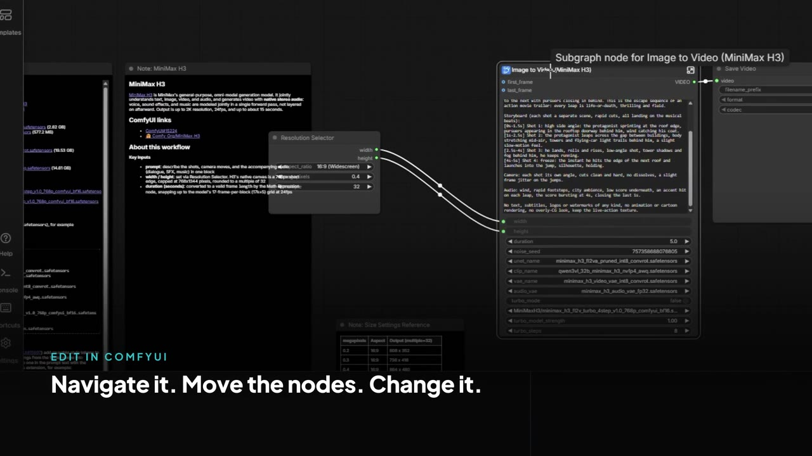
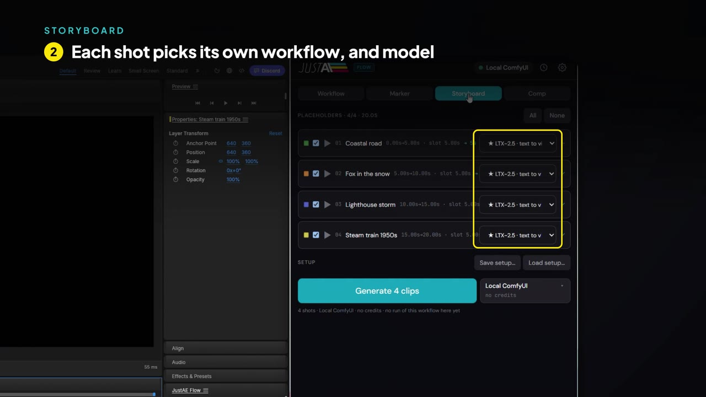
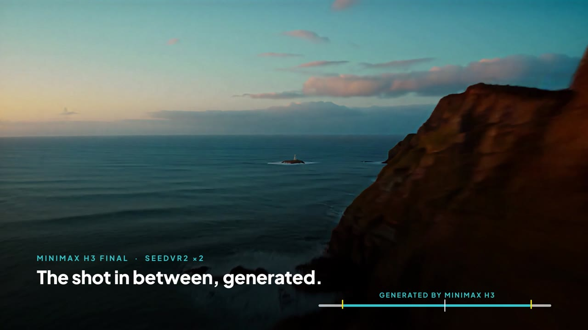
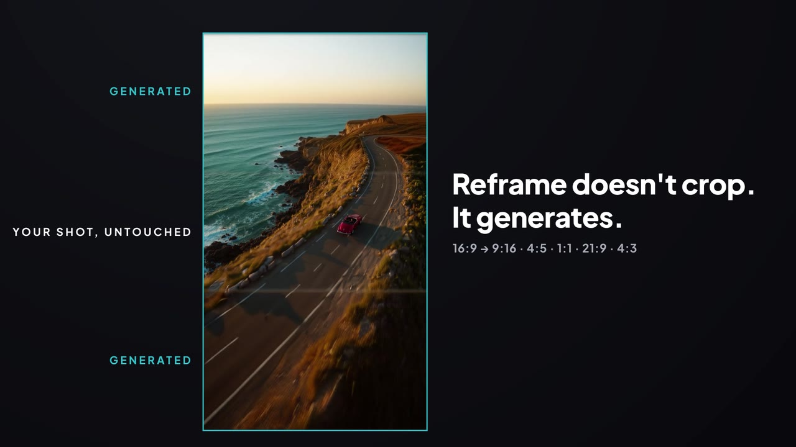
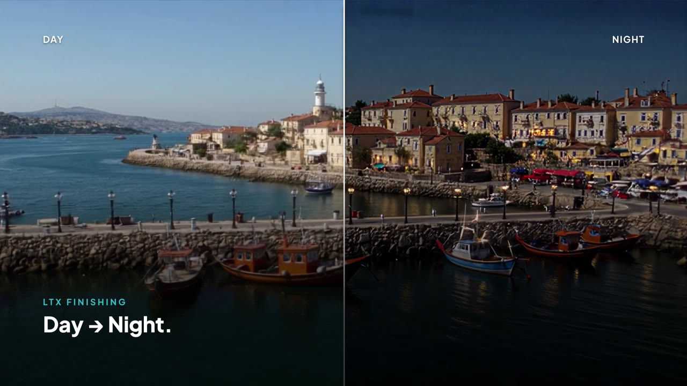
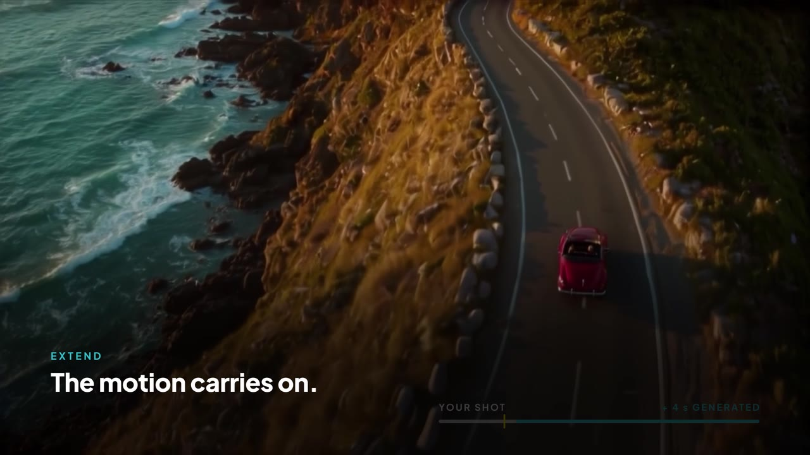

<p align="center">
  <picture>
    <source media="(prefers-color-scheme: dark)" srcset="client/public/justae-logo-white.svg">
    
  </picture>
</p>

<h1 align="center">JustAE Flow</h1>

<p align="center">
  <b>ComfyUI inside the open-source EffectCraft.</b><br>
  Your ComfyUI workflows, with any model, run on your timeline: generate shots, fill the gap between two clips,
  reframe without cropping, upscale, cut out, extend and restore — on your own GPU or on Comfy's.
</p>

https://github.com/user-attachments/assets/ce75db72-97ce-42d5-8f43-b38c6abea809

<p align="center"><sub>▶ The two-minute demo · <a href="https://raw.githubusercontent.com/HomoLapis/justae-flow/main/docs/media/justae-flow-demo.mp4">download it in 1080p (39 MB)</a></sub></p>

<p align="center">
  <a href="docs/SETUP.md">Setup</a> · <a href="docs/GUIDE.md">Guide</a> · <a href="https://justae.homolapis.ai/">JustAE for After Effects</a> · <a href="https://homolapis.ai/">Homo Lapis</a>
</p>

<p align="center">GPL-3.0 · any ComfyUI workflow, any model · open-weight presets · no telemetry · no account</p>

---

[EffectCraft](https://github.com/storytold/effectcraft) is an open-source compositor that works like After Effects.
JustAE Flow adds a window next to its timeline where [ComfyUI](https://github.com/comfyanonymous/ComfyUI) does the
generating. You block out a cut with placeholders or markers, write what happens in each shot, press Generate, and the
clips come back in their slots. A **Comp tab** works on the whole comp: a vertical version, a sharper master, a cut-out
with alpha, a few more seconds. Every result goes into the project as a new layer or comp, next to your work, never
over it, with its versions and the exact workflow that made it.

## Your ComfyUI, your workflows

<p align="center">
  
</p>

It's your usual ComfyUI, with your workflows and your models. The Workflow tab lists the workflows saved in your
ComfyUI (or imports a file) and turns each one into a form; the comp fills in the size, the length and the frame rate.
**Edit in ComfyUI** opens the same workflow in the ComfyUI editor. Change the nodes, the model, the settings, save,
and the panel picks it up.

Nothing is tied to one model. Each storyboard row and each marker pair chooses its own workflow, so one shot can use
LTX-2.5 and the next MiniMax H3 or Wan 2.2, or something of yours. The **Featured** presets are there to start with:
they say what is ready on your machine and download only the models you tick. The Comp tab's tools are presets too,
and you can change them.

JustAE Flow works only with ComfyUI: yours, or Comfy's in the cloud.

## What it does

<table>
<tr>
<td width="50%"></td>
<td><b>A storyboard from the timeline.</b> Add placeholder layers where the shots go. Each one becomes a row with its
own workflow. Write what happens in it, press Generate: the shots are made one after the other, with their sound, and
dropped in their slots at the right size and length.</td>
</tr>
<tr>
<td></td>
<td><b>The shot between two clips.</b> Put two markers around a gap. The panel takes the last frame of one clip and
the first of the next from the comp, and a first-and-last-frame model (MiniMax H3 here, or Wan 2.2) makes the shot
that joins them, exactly as long as the gap.</td>
</tr>
<tr>
<td></td>
<td><b>Reframe that generates.</b> 16:9 to 9:16, 4:5, 1:1, 21:9 or 4:3. Instead of cropping, Wan 2.1 VACE paints the
space the new format needs around your shot, which stays untouched in the middle, colours matched. A social pack makes
several formats in one go.</td>
</tr>
<tr>
<td></td>
<td><b>Upscale and finishing.</b> SeedVR2 ×2 or ×4 adds real detail and keeps the colours. LTX Refine rebuilds detail
up to 4K and 8K, tile by tile. Lightricks' IC-LoRAs become tools on the comp: Archive restore, Deblur, De-compression,
Colorize, Clean plate, Day → Night, SDR → HDR, with 16-bit masters.</td>
</tr>
<tr>
<td></td>
<td><b>Cut-out with alpha.</b> Name the subject in a word. SAM 3 tracks it through the clip, or LTX Alpha keeps the
soft edges. The matte goes on the layer as a track matte; one click writes a ProRes 4444 with alpha.</td>
</tr>
<tr>
<td></td>
<td><b>Extend and slow down.</b> LTX-2.5 continues the motion of the last frames into two to five new seconds; a local
vision model can write the prompt from your footage. RIFE or FILM add the frames in between for slow motion.</td>
</tr>
</table>

## How it works

```
EffectCraft ── control channel ──┐
                                 ├── JustAE Flow server (Node, on this machine only)
Flow window (docked) ────────────┘        │
                                          └── your ComfyUI · a Comfy API deployment · Comfy Cloud
```

- The **server** runs on your machine and listens on 127.0.0.1 only. It talks to EffectCraft over its control channel
  (markers, layers, frames, renders) and to ComfyUI over its normal HTTP and WebSocket API.
- The **Flow window** is a web app, docked beside EffectCraft. It never holds a key: the server keeps the keys in your
  user folder and relays the requests.
- A **workflow** is read as a form. Prompts, images and frames come from the comp; the output comes back through the
  server and is placed in the project. Each run keeps its inputs, its output, the workflow it ran and a `job.json` of
  every value used, in a folder next to the project.
- **Where it runs** is your choice, per task: your local ComfyUI, your own Comfy API deployment, or Comfy Cloud, with
  one platform API key. Before a run the button shows an estimate of time and credits; after it, what the run used.
  Without a key everything stays on your machine.

## Get started

You need Node.js 22.18+, EffectCraft 0.11.1 or newer, ComfyUI 0.38+ and ffmpeg.

```bash
git clone https://github.com/HomoLapis/justae-flow.git && cd justae-flow
npm run setup        # install and build the window
npm run launch       # the server, EffectCraft, and the Flow window docked beside it
```

On Windows, double-click **JustAE Flow.cmd** instead. If EffectCraft is already open, save and close it first: the
launcher starts it with its control channel, which an EffectCraft opened from its own icon does not have. On Windows
the launcher also sets that up for your user, so after the first run the Start menu works too.

The first time, the Workflow tab opens on **Get started**: it finds your ComfyUI, says which presets are ready, offers
the missing models for download and makes a test image in your comp.

The models, the Hugging Face terms for the LTX files, running without a GPU on the Comfy Developer Platform: read
**[Setup](docs/SETUP.md)**. Every tab and tool, with what was measured: **[the guide](docs/GUIDE.md)**.

## Open all the way down

| | |
|---|---|
| Host | [EffectCraft](https://github.com/storytold/effectcraft) (MIT OR Apache-2.0); [PhotoCraft](https://github.com/storytold/photocraft) for stills |
| Engine | [ComfyUI](https://github.com/comfyanonymous/ComfyUI) (GPL-3.0) and its official workflow templates (MIT) |
| Models | any model your ComfyUI runs. The presets use open weights only: LTX-2.5, MiniMax H3, Wan 2.2, Wan 2.1 VACE, SeedVR2, SAM 3, Z-Image-Turbo, Qwen-Image-Edit, Qwen3-VL, RIFE, FILM |
| This plugin | GPL-3.0: the server, the Flow window, the EffectCraft panel |

Model weights are not included. Each model keeps its own licence, listed in [NOTICE](NOTICE); read them before using
the outputs commercially.

## Who makes it

[Homo Lapis](https://homolapis.ai/) is a creative AI studio in Gorizia, Italy: motion design and generative AI for
broadcasters, museums and brands. JustAE Flow comes out of the studio's own work on the timeline.

The same idea exists as a real plugin for Adobe After Effects: **JustAE**, at
[justae.homolapis.ai](https://justae.homolapis.ai/). There is also a more advanced, smarter edition, not public, and
plenty of ideas to take the tool further. If that interests you, [write to us](https://homolapis.ai/contact/).

## Licence

GPL-3.0, see [LICENSE](LICENSE). Third-party material and model licences are in [NOTICE](NOTICE). The JustAE name and
logo are not covered by the code licence, see [TRADEMARKS.md](TRADEMARKS.md). EffectCraft and PhotoCraft are products of
the ArtCraft Team; JustAE Flow is an independent project, not affiliated with or endorsed by them.
